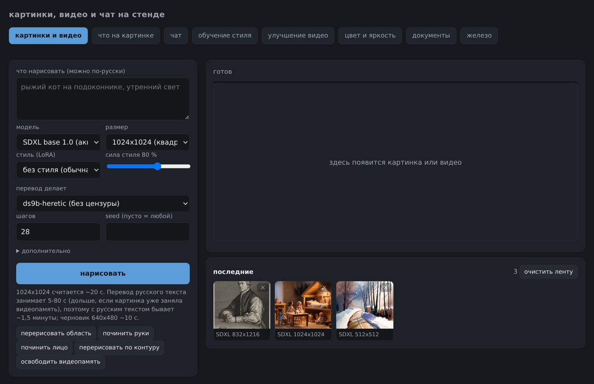

# stand-panel

One page in the browser for a machine with a GPU: images, video, chat with a local
model, style training, video upscaling, colour grading, a closed document base, and
hardware — load, temperatures, watts, disk space.

Everything runs on your own box. The panel publishes nothing: it listens on `127.0.0.1`
only and talks to your ComfyUI and your ollama. No clouds, no API keys.

Written in Python with no dependencies: `http.server` from the standard library, one
page, JSON in between. The optional `psutil` is needed only for the hardware tab.

*Русская версия: [README.ru.md](README.ru.md).*



A real screenshot from the box the panel was written for: Russian prompt in the field,
translation and model on the right, the recent strip below (test generations only).

## What you need

- Linux, Python 3.10+ (tested on 3.12 and 3.14);
- ComfyUI with SDXL checkpoints (`sd_xl_base_1.0`, Juggernaut XI or RealVis XL v5) —
  the panel talks to its HTTP API on `127.0.0.1:8188`;
- ollama with a translator model (`qwen3:8b`) on `127.0.0.1:11434`;
- `ffmpeg`/`ffprobe` if you want the video tabs;
- `psutil` (`python3 -m pip install --user psutil`) if you want the hardware tab.

The style-training, video-upscaling and documents tabs call external scripts and images
that are **not in this repository** (see "What is not here"). Without them the panel
works, and those tabs honestly say what is missing.

## Install

No sudo. The panel installs under your own user into `~/panels/stand-panel`, and starts
from a systemd *user* unit.

```bash
git clone https://github.com/piroman99/stand-panel && cd stand-panel
bash install.sh            # copy code, create panel.env, install the unit
bash install.sh status     # unit, port, and a live check of the API
bash install.sh logs       # journal
bash install.sh restart    # restart (queued jobs survive)
bash install.sh remove     # remove the unit; code and panel.env stay
```

Another directory or port:

```bash
PREFIX=$HOME/tools/panel PORT=9000 bash install.sh
```

An agent (Claude Code, Codex, nanobot and friends) can do the install itself — there is a
separate instruction with acceptance checks: [AGENTS.md](AGENTS.md).

After install the panel is at `http://127.0.0.1:8288/`. From another machine use a tunnel;
the port is never exposed:

```bash
ssh -N -L 8288:127.0.0.1:8288 <user>@<host>
# then open http://127.0.0.1:8288/ in the browser
```

## Configuration

Everything machine-specific lives in `panel.env` next to the code (template:
[panel.env.example](panel.env.example)); the systemd unit reads it. The main knobs:

| variable | default | meaning |
|---|---|---|
| `COMFY_API` | `http://127.0.0.1:8188` | ComfyUI address |
| `OLLAMA_API` | `http://127.0.0.1:11434` | ollama address |
| `COMFY_HOME` | `~/ComfyUI` | ComfyUI root (`output/`, `input/`, `models/loras/` are relative to it) |
| `UI_TRANSLATOR` | `qwen3:8b` | Russian → prompt translator model |
| `UI_VISION_MODEL` | `qwen3-vl:8b` | vision model for "what is in this picture" |
| `UI_DISKS` | `/home` | extra disks to show: `label=path,label=path` |
| `UI_CHAT_CTX` | `16384` | chat context window; the selector in the page overrides it |
| `UI_CHAT_MAX_TOKENS` | `3000` | cap on answer length, so a looping model cannot run for minutes |
| `UI_SATA_MOUNT` | empty | separate models disk, if you have one |
| `UI_COMFY_IN_CONTAINER` | `0` | `1` — ComfyUI runs in docker and the panel may recreate it when it loses the GPU |

## Tabs

| tab | what it does |
|---|---|
| images and video | Russian text → translation → ComfyUI; model, size, steps, seed, LoRA; region repaint; "fix hands/face", "fix by outline"; recent strip |
| chat | talk to a local model; "draw …" goes to ComfyUI and comes back as a picture; attach an image and ask what is in it. If the model starts repeating one paragraph, the panel cuts the answer off itself |
| style training | photos + a style name → LoRA in an external trainer, with progress and stop *(external script, not included)* |
| video upscaling | CUDA networks, processing chunk by chunk *(external image, not included)* |
| colour and brightness | per-frame measurement and repair of only what is broken: shadow desaturation, gamma, contrast, saturation |
| documents | closed base: ask questions about uploaded files *(external stack, not included)* |
| hardware | CPU, memory, GPU and disk load (throughput and busy time), temperatures, CPU and GPU watts, disk space; refreshed every three seconds |

`stand_guard.py` is a prompt filter: it refuses to draw minors in a sexual context. It
checks both the Russian text and the translation, because the translator can add a word
the source never had. Without it the panel refuses to draw at all.

## API

The panel is an HTTP server; the browser gets one page, data travels as JSON.

```
GET  /api/config     models, sizes, modes, hints
GET  /api/history    recent strip
POST /api/generate   {prompt, model, size, steps, seed, lora, lora_w}
POST /api/inpaint    repaint a region
POST /api/detail     fix hands/face/outline
POST /api/chat       {model, messages, think, draw}
POST /api/train/*    style training
POST /api/video/*    video upscaling
GET  /api/grade      video list and current grading parameters
POST /api/grade/preview | /api/grade/apply
POST /api/doc        document base control
GET  /api/sys        hardware: CPU, memory, GPU, disks, temperatures
```

Jobs run in the background: `GET /api/queue` and `GET /api/job/<id>`.

## Measurements

Box: Xeon E5-2680 v4 (14 cores), 30 GB RAM, RTX 5060 Ti 16 GB, Ubuntu 26.10, Python 3.12.

- SDXL 1344×768, 28–30 steps, dpmpp_2m-karras — 11–12 s warm; 16–21 s with ControlNet depth;
- the hardware tab serves `/api/sys` in 40–80 ms; a 3 s refresh costs almost nothing;
- CPU watts come from the RAPL counter. It is root-only by default:
  `/sys/class/powercap/intel-rapl:0/energy_uj`. A one-time `sudo chmod 444` on that file
  makes watts appear without root on every request. Otherwise the panel simply does not
  show watts and says so in a hint.

## What is not here

- model weights and docker images (tens of gigabytes);
- the external scripts and images for LoRA training, video upscaling and the document
  base — the tabs exist, the files they call do not;
- your data: generation history, datasets, trained LoRAs, `panel.env`.

## Caveats

- Small quantised models degenerate on long answers: they may repeat one sentence until
  the context window fills. The panel fights this in two ways — anti-repetition sampler
  settings (`repeat_penalty`, `repeat_last_n`, `presence_penalty`, all tunable through
  `UI_CHAT_*`) and a loop guard that closes the stream as soon as a ten-word stretch
  repeats four times. The answer is then cut short and says why.
- The panel was written for one specific box and assumes one or two users on a trusted
  network. It is a tool for yourself, not a multi-user product: there is no
  authentication, so never expose the port.
- No compatibility promises. Tested on Ubuntu 26.10 with Python 3.12.16 and Python 3.14;
  another machine may need edits.
- The "fix hands" and "fix face" buttons need detectors (`ultralytics`, hand/face
  detection models) and ControlNet inside ComfyUI; without them the panel tells you what
  is missing.

## License

MIT — see [LICENSE](LICENSE).
