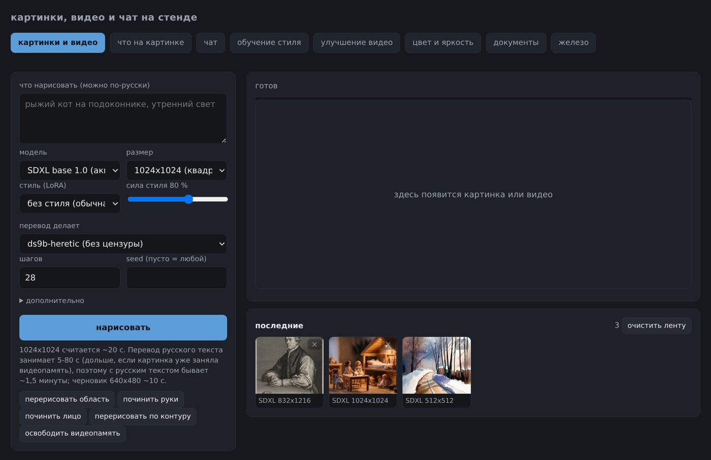
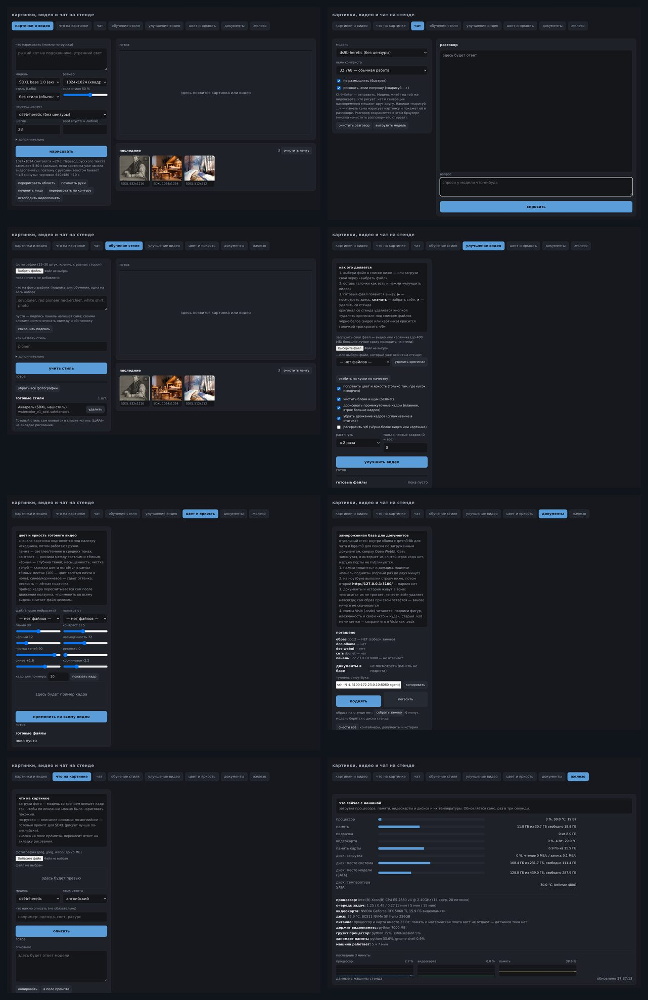
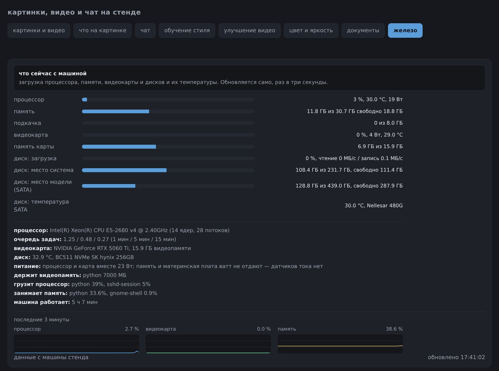

# панель стенда (stand-panel)

Одна страница в браузере для машины с видеокартой: картинки, видео, чат с локальной
моделью, обучение стиля, улучшение видео, цвет, закрытая база документов и железо —
загрузка, температуры, ватты, место на дисках.

Всё считается на своей машине: панель не публикует наружу ни одной страницы, слушает
только `127.0.0.1` и ходит к вашему ComfyUI и вашему ollama. Никаких облаков и API-ключей.

Написана на Python без зависимостей: `http.server` из стандартной библиотеки, одна
страница, данные — JSON. Необязательный `psutil` нужен только для вкладки «железо».

*English version: [README.md](README.md).*



Настоящий скриншот с той машины, для которой панель писалась: русский промпт в поле,
перевод и модель справа, лента последних генераций снизу (в ленте только тестовые).

Все восемь вкладок на одном листе — [docs/tabs.jpg](docs/tabs.jpg):



Снимки сделаны на самой машине: страницу отдавал тот же `stand-ui`, что работает на
`127.0.0.1:8288`, данные — его же JSON-ответы. Ничего не дорисовывалось.

Вкладка «железо» крупно — температура, ватты, место на обоих дисках:



## Что нужно на машине

- Linux, Python 3.10+ (проверено на 3.12 и 3.14);
- ComfyUI с моделями SDXL (`sd_xl_base_1.0`, Juggernaut XI или RealVis XL v5) —
  панель обращается к его HTTP API на `127.0.0.1:8188`;
- ollama с моделью-переводчиком (`qwen3:8b`) на `127.0.0.1:11434`;
- `ffmpeg`/`ffprobe` в системе, если нужны вкладки с видео;
- `psutil` (`python3 -m pip install --user psutil`), если нужна вкладка «железо».

Вкладки «обучение стиля», «улучшение видео» и «документы» вызывают внешние скрипты и
образы, которых **в этом репозитории нет** (см. «Чего здесь нет»). Без них панель
работает, а эти вкладки честно скажут, чего не хватает.

## Установка

Никакого sudo: панель ставится под своим пользователем в `~/panels/stand-panel`,
автозапуск — пользовательский юнит systemd.

```bash
git clone https://github.com/piroman99/stand-panel && cd stand-panel
bash install.sh            # скопировать код, создать panel.env, поставить юнит
bash install.sh status     # юнит, порт и живой ответ API
bash install.sh logs       # журнал
bash install.sh restart    # перезапуск (очередь задач не теряется)
bash install.sh remove     # снять юнит, код и panel.env остаются
```

Другие каталог и порт:

```bash
PREFIX=$HOME/tools/panel PORT=9000 bash install.sh
```

Поставить может и агент ([CC], Codex, nanobot и подобные) — для них есть
отдельная инструкция с проверками: [AGENTS.md](AGENTS.md).

После установки панель доступна по `http://127.0.0.1:8288/`. С другой машины —
через туннель, наружу порт не выставляется:

```bash
ssh -N -L 8288:127.0.0.1:8288 <пользователь>@<машина>
# затем в браузере: http://127.0.0.1:8288/
```

## Настройка

Всё, что зависит от вашей машины, — переменные окружения в `panel.env` рядом с кодом
(шаблон: [panel.env.example](panel.env.example)). Файл читает юнит systemd. Главное:

| переменная | по умолчанию | что задаёт |
|---|---|---|
| `COMFY_API` | `http://127.0.0.1:8188` | адрес ComfyUI |
| `OLLAMA_API` | `http://127.0.0.1:11434` | адрес ollama |
| `COMFY_HOME` | `~/ComfyUI` | корень ComfyUI (от него `output/`, `input/`, `models/loras/`) |
| `UI_TRANSLATOR` | `qwen3:8b` | модель-переводчик русский → промпт |
| `UI_VISION_MODEL` | `qwen3-vl:8b` | модель со зрением для «что на картинке» |
| `UI_DISKS` | `/home` | какие диски показывать: `метка=точка,метка=точка` |
| `UI_CHAT_CTX` | `16384` | окно контекста чата; селектор в странице его перекрывает |
| `UI_CHAT_MAX_TOKENS` | `3000` | потолок длины ответа, чтобы залипшая модель не молотила минутами |
| `UI_SATA_MOUNT` | пусто | отдельный диск под модели (если он есть) |
| `UI_COMFY_IN_CONTAINER` | `0` | `1` — ComfyUI в docker, панель сама пересоздаёт его при потере видеокарты |

## Вкладки

| вкладка | что делает |
|---|---|
| картинки и видео | текст по-русски → перевод → ComfyUI; модель, размер, шаги, seed, LoRA; видео-модели (LTXV 2B, Wan 2.2 5B, в том числе «первый и последний кадр») рисуют клип из 2–5 с; перерисовка области; «починить руки/лицо», «починить по контуру»; лента последних |
| что на картинке | загрузить фото → модель со зрением опишет кадр: по-русски словами, по-английски — готовым промптом для SDXL; ответ одной кнопкой переносится в поле рисования |
| чат | разговор с локальной моделью; «нарисуй …» уходит в ComfyUI и возвращается картинкой; можно приложить картинку и спросить, что на ней; если модель начинает повторять один абзац, панель сама обрывает ответ |
| обучение стиля | фото + имя стиля → LoRA во внешнем тренере, прогресс и «остановить» *(внешний скрипт, не входит)* |
| улучшение видео | нейросети на CUDA, обработка по кускам *(внешний образ, не входит)* |
| цвет и яркость | замер по кадрам и правка только испорченного: гашение цвета в тенях, гамма, контраст, насыщенность |
| документы | закрытая база: вопрос по загруженным файлам *(внешний стек, не входит)* |
| железо | загрузка процессора, памяти, видеокарты и диска (сколько читает и пишет), температуры, ватты процессора и карты, место на дисках; обновляется раз в три секунды |

`stand_guard.py` — фильтр промптов: не даёт нарисовать несовершеннолетних в сексуальном
контексте. Проверяет и русский текст, и перевод, потому что переводчик может добавить
слово, которого в исходной фразе не было. Без него панель отказывается рисовать.

## API

Панель сама по себе — HTTP-сервер; браузеру отдаётся одна страница, данные ходят JSON-ом.

```
GET  /api/config     модели, размеры, режимы, подсказки
GET  /api/history    лента последних
POST /api/generate   {prompt, model, size, steps, seed, lora, lora_w,
                     length, fps, start_image, end_image}   # видео-модели
POST /api/inpaint    перерисовать область
POST /api/redraw     перерисовать кадр целиком по контуру/глубине/позе/линиям/плитке
POST /api/detail     починить руки/лицо (детектор кистей/лиц + ControlNet)
POST /api/chat       {model, messages, think, draw}
POST /api/train/*    обучение стиля
POST /api/video/*    улучшение видео
GET  /api/grade      список видео и текущие параметры
POST /api/grade/preview | /api/grade/apply
POST /api/doc        управление базой документов
GET  /api/sys        железо: процессор, память, видеокарта, диски, температуры
```

Задачи идут в фоне: `GET /api/queue` и `GET /api/job/<id>`.

## Замеры

Стенд: Xeon E5-2680 v4 (14 ядер), 30 ГБ, RTX 5060 Ti 16 ГБ, Ubuntu 26.10, Python 3.12.

- SDXL 1344×768, 28–30 шагов, dpmpp_2m-karras — 11–12 с (тёплый), с ControlNet depth 16–21 с;
- вкладка «железо» отдаёт `/api/sys` за 40–80 мс, обновление раз в 3 с почти ничего не стоит;
- ватты процессора читаются из счётчика RAPL. По умолчанию он закрыт: файл
  `/sys/class/powercap/intel-rapl:0/energy_uj` доступен только root. Разово
  `sudo chmod 444` на него — и ватты появляются в панели без root на каждый запрос.
  Без этого панель просто не показывает ватты и пишет об этом подсказкой.

## Чего здесь нет

- весов моделей и образов (десятки гигабайт);
- внешних скриптов и образов для обучения LoRA, улучшения видео и базы документов —
  вкладки есть, вызываемых файлов в репозитории нет;
- ваших данных: истории генераций, датасетов, готовых LoRA, `panel.env`.

## Оговорки

- Маленькие квантованные модели вырождаются на длинных ответах: могут повторять одно
  предложение, пока не забьют окно контекста. Панель борется с этим двумя способами —
  сэмплеры против повторов (`repeat_penalty`, `repeat_last_n`, `presence_penalty`, всё
  настраивается через `UI_CHAT_*`) и сторож, который закрывает поток, как только
  десятисловный кусок повторился четыре раза. Ответ обрывается и говорит почему.
- Панель писалась под конкретный стенд и рассчитана на один-два пользователя в доверенной
  сети. Это инструмент для себя, а не многопользовательский продукт: авторизации нет,
  поэтому наружу порт не выставляйте.
- Совместимость ни с чем не обещается. Проверено на Ubuntu 26.10 с Python 3.12.16 и
  Python 3.14; на другой машине возможны правки.
- Кнопки «починить руки» и «починить лицо» требуют в ComfyUI детекторы
  (`ultralytics`, модели детекции кистей/лиц) и ControlNet; без них панель скажет,
  чего не хватает.

## Лицензия

MIT — см. [LICENSE](LICENSE).
